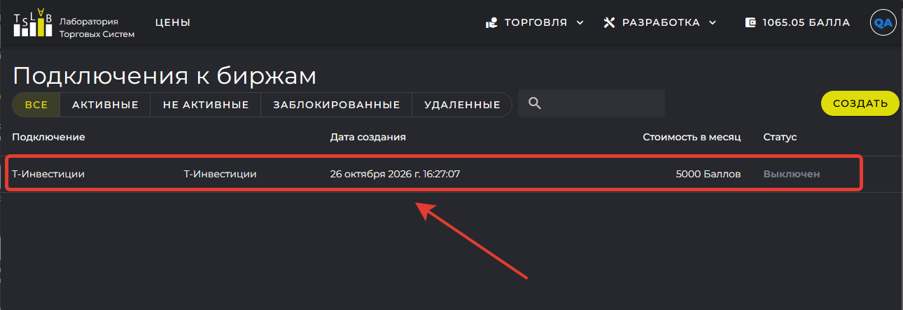
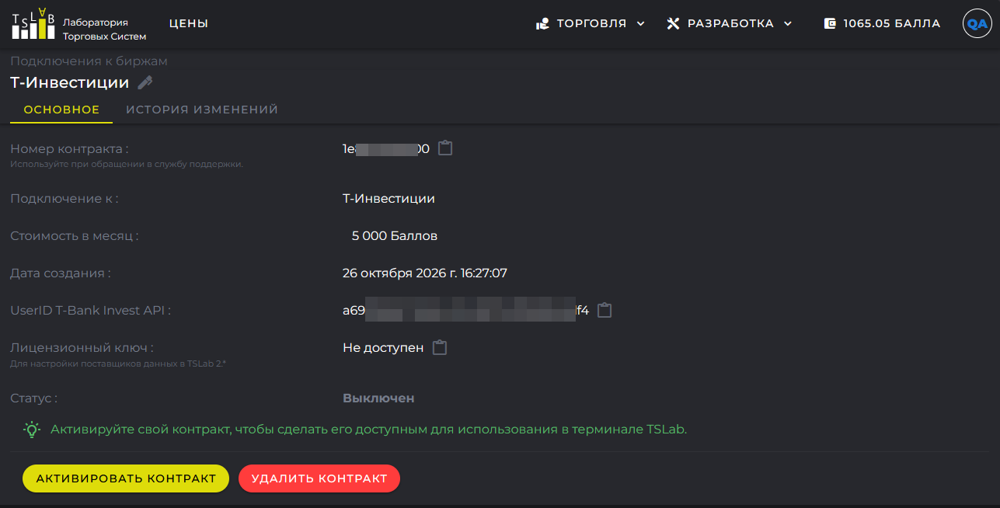

Контракт -- это запись в сервисе TSLab Online, которая связывает вашу учётную запись, выбранный тарифный план и данные доступа к бирже или брокеру. Сервис создаёт контракт в момент оформления подписки и формирует для него лицензионный ключ.

Контракт расширяет возможности программы. Без контракта TSLab работает с историческими данными: вы собираете скрипты, тестируете стратегии на истории и осваиваете интерфейс. С контрактом программа подключается к серверам биржи или брокера, получает котировки в реальном времени и отправляет торговые поручения.

Тарифный план определяет, к какой бирже или брокеру подключается программа, а данные доступа -- под каким ключом или логином она это делает. Что считать данными доступа, зависит от поставщика: у криптовалютных бирж это публичный API-ключ, у поставщиков на основе QUIK Lua -- идентификатор терминала QUIK, у Финама -- логин TransaqConnector. Контракт работает только с указанным значением: если оно неверно, поставщик данных не подключится.

<note>
  По одному контракту можно работать на нескольких компьютерах, но ограничения на одновременные подключения устанавливает сам поставщик. Например, подключиться с одним логином TransaqConnector к серверу Финама с разных машин нельзя. Условия конкретного поставщика описаны в разделе «Поставщики данных».

  Торговать одним инструментом с одной учётной записи с разных компьютеров не следует. Программы не знают о заявках друг друга: каждая считает позицию по своим данным, поэтому объём задваивается, а позиция на счёте расходится с расчётами агентов.
</note>

Второй контракт нужен в другом случае -- когда вы хотите подключиться к той же бирже под другим ключом или логином. Сервис выпишет для него отдельный лицензионный ключ. Несколько подписок на один и тот же тарифный план допускаются: по каждой создаётся отдельный контракт.

Со счетами у брокера контракт напрямую не связан. Например, к одному логину TransaqConnector брокер подключает счета разных рынков, и всем им достаточно одного контракта. Счета к логину подключаются в личном кабинете брокера.

Указанные при оформлении подписки данные доступа входят в контракт.

<note>
  Секретный ключ и пароль остаются в программе на вашем компьютере. Сервис TSLab Online их не получает и не хранит: на сервер передаются только публичные данные доступа -- API-ключ, идентификатор терминала или логин.
</note>

В TSLab 2.2 лицензионный ключ копировали из личного кабинета и вставляли в программу вручную. В версии 3.0 программа запрашивает список контрактов с сервера сама, сразу после входа в учётную запись.

## Где найти свои контракты

Контракты хранятся в личном кабинете на сайте. Откройте `www.tslab.ru`, войдите в учётную запись и выберите в верхнем меню **Торговля** -> **Подключения**. Откроется страница **Подключения к биржам** со списком ваших контрактов.

В таблице показаны название подключения и тарифный план, дата создания, стоимость в месяц и текущий статус. Название контракта вы задаёте сами при оформлении подписки и можете изменить в любой момент -- оно нужно только для того, чтобы различать контракты в списке.

Над таблицей расположены кнопки фильтра: **Все**, **Активные**, **Не активные**, **Заблокированные**, **Удаленные**. По умолчанию выбран фильтр **Все** -- он показывает контракты в любом статусе, кроме удалённых. Чтобы увидеть удалённые контракты, нажмите **Удаленные**.

Чтобы открыть свойства контракта, щёлкните по его строке в таблице.

{width=1290px height=444px}

## Статусы контракта

Статус показан в таблице подключений и в свойствах контракта. От него зависит, работает ли подписка и что с ней можно сделать.

- **Выключен** -- контракт создан, но ещё ни разу не активирован. Этот статус получают платные подписки, оформленные на сайте: сервис создаёт контракт, а плату начинает списывать только после активации. Лицензионного ключа у такого контракта ещё нет, и в программе он не появляется. Бесплатные тарифные планы активируются сразу при создании.
- **Активен** -- контракт работает. По нему создаются поставщики данных, и с Лицевого счёта ежедневно списывается плата.
- **Заблокирован** -- контракт работал, но на оплату очередного дня не хватило Баллов. Поставщики данных перестают работать, списания прекращаются, а контракт и данные доступа сохраняются. Срок блокировки не ограничен: контракт хранится, пока вы не удалите его сами. Чтобы вернуться к работе, пополните Лицевой счёт и активируйте контракт -- на Балансе должно хватать Баллов хотя бы на один день работы по тарифу. О том, что Баллы заканчиваются, сервис предупреждает письмом заранее, не дожидаясь блокировки. Подробно о блокировке рассказано в статье «Лицевой счёт и оплата подписок».
- **Удален** -- контракт удалён вами. Лицензионный ключ заблокирован, подписка прекращена, запись остаётся в истории.

## Свойства контракта

Свойства открываются щелчком по строке контракта в таблице. Вверху показано название контракта и карандаш для переименования, а данные разнесены по двум вкладкам.

### Вкладка «Основное»

На этой вкладке собраны параметры подписки:

- **Номер контракта** -- идентификатор, который называют при обращении в службу поддержки. Значение копируется значком рядом с полем.
- **Подключение к** -- тарифный план. Если тариф даёт доступ к нескольким рынкам, они перечислены под его названием.
- **Стоимость в месяц** -- месячная стоимость тарифного плана, у бесплатных тарифов указано «Бесплатно».
- Данные доступа -- название поля зависит от поставщика: **API Key (public)**, **Торговый аккаунт** и подобные. У активного контракта значение меняется карандашом рядом с полем: оформлять новую подписку ради смены ключа не нужно.
- **Лицензионный ключ** -- ключ для настройки поставщиков данных в TSLab 2.x. Значение скрыто, показывается значком с глазом. Пока контракт не активирован, ключа нет и в поле написано «Не доступен».
- **Статус** -- текущее состояние контракта.

Внизу вкладки расположены кнопки действий. У активного контракта доступно только **Удалить контракт**. У выключенного и заблокированного рядом с ней стоит **Активировать контракт**.

{width=1287px height=654px}

### Вкладка «История изменений»

Здесь собраны события по контракту: дата, событие и примечание к нему. В истории видно, когда контракт создали и активировали, когда выписали лицензионный ключ, какие списания прошли и что меняли в данных доступа. События идут от новых к старым.

История пригодится, когда нужно восстановить картину: с какого дня контракт работает, сколько списаний прошло, когда менялся ключ доступа.

## Как оформить подписку

Подписку оформляют двумя способами -- в программе и на сайте. Результат одинаковый: сервис создаёт контракт. Различается порядок действий и момент, когда контракт начинает работать.

- **В программе.** TSLab создаёт контракт вместе с поставщиком данных и сразу активирует его: плата за первый день списывается в момент создания. Так вы получаете готовое подключение за один проход.
- **На сайте.** На странице **Подключения** нажмите **Создать** и пройдите три шага: выбор поставщика и тарифа, условия тарифа, данные доступа и название контракта. Контракт создаётся со статусом **Выключен** -- активируете его вы сами, когда будете готовы.

Какие данные доступа нужны конкретному поставщику и как их получить, описано в разделе «Поставщики данных».

## Как активировать контракт

Активация нужна в двух случаях: контракт оформлен на сайте либо заблокирован из-за нехватки Баллов.

Откройте свойства контракта и нажмите **Активировать контракт**. Подтверждения сервис не запрашивает, контракт активируется сразу. Статус меняется на **Активен**, появляется лицензионный ключ, контракт становится доступен в программе, а со счёта списывается плата за текущий день.

Плата берётся за весь календарный день независимо от того, в котором часу вы активировали контракт.

## Как отменить подписку

Приостановить контракт нельзя: временной остановки в сервисе нет. Единственный способ прекратить подписку -- удалить контракт.

Откройте свойства контракта, нажмите **Удалить контракт** и подтвердите действие в открывшемся окне. После удаления:

- лицензионный ключ блокируется, и поставщики данных по этому контракту перестают работать сразу;
- плата за текущий день остаётся списанной: минимальный оплачиваемый период -- один день;
- со следующего дня списания прекращаются;
- контракт получает статус **Удален** и остаётся в списке на фильтре **Удаленные**.

Удаление необратимо: чтобы вернуться к работе, нужно оформить новую подписку. Поскольку текущий день уже оплачен, удалять контракт выгоднее в конце дня.

<note>
  Нехватка Баллов контракт не удаляет, а блокирует: данные доступа сохраняются, и работу можно возобновить в любой момент. Удаление же отменяет подписку окончательно.
</note>

Если сайт недоступен из-за технических работ, обратитесь в службу поддержки -- отмену подписки выполнят по вашему обращению и учтут днём его получения.
