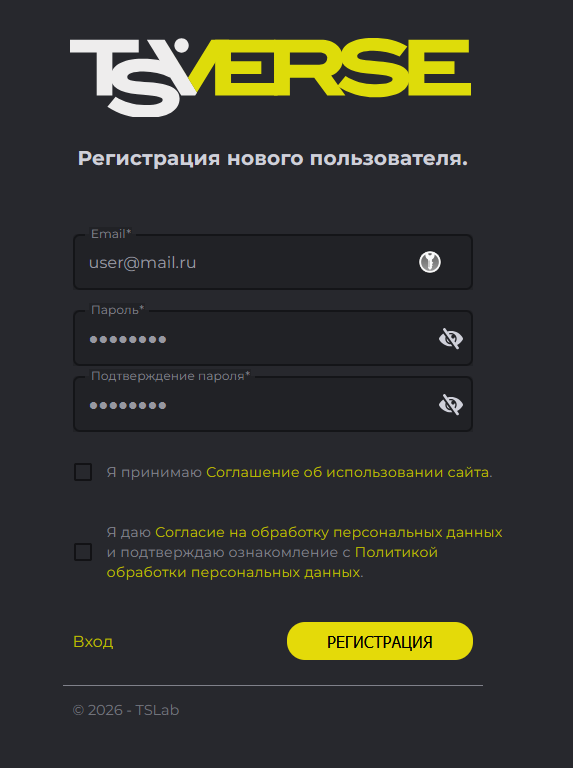
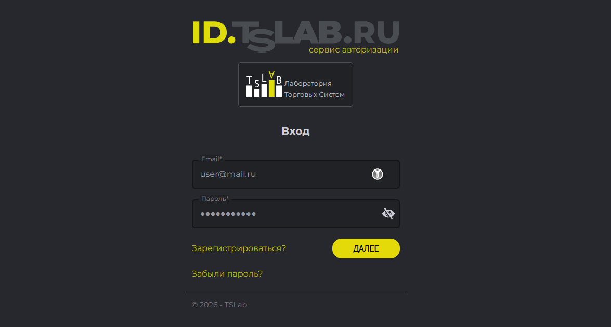
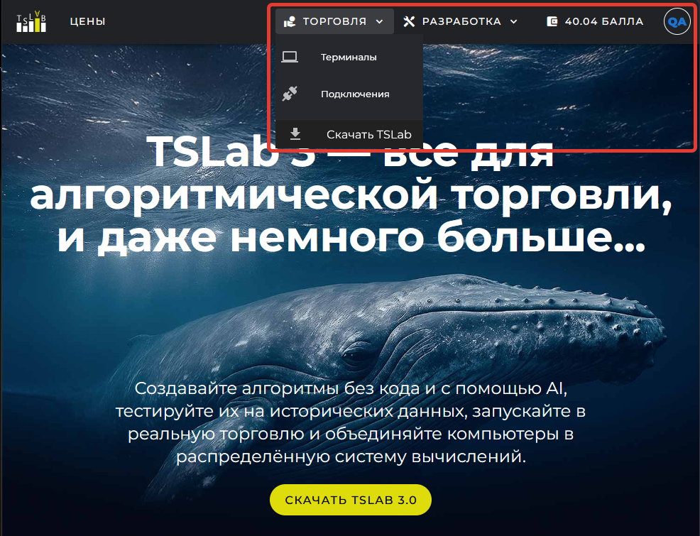

Для работы с TSLab нужна одна учётная запись: она открывает доступ и к сайту `www.tslab.ru`, и к самой программе. На сайте вы оформляете подписки на поставщиков данных, пополняете Лицевой счёт и видите, сколько Баллов списано за каждый день работы ваших подключений. В программе та же учётная запись подтверждает ваше право на работу: TSLab 3.0 запускается и без входа, но большинство функций остаётся заблокированным, пока вы не авторизуетесь.

Порядок первых действий такой: зарегистрируйтесь на сайте, подтвердите адрес почты, а затем войдите в программу под теми же данными.

## Если вы уже пользовались сайтом tslab.pro

База учётных данных у старого и нового сайтов общая, поэтому регистрироваться заново не нужно. Откройте `www.tslab.ru` и войдите той же почтой и тем же паролем, которыми пользовались на `tslab.pro`.

Общими остаются только учётные данные. Сведения о контрактах из старого кабинета в новый не переносятся: контрактов, оформленных на `tslab.pro`, в разделе **Подключения** не будет.

## Регистрация

Регистрация состоит из двух частей: вы заполняете форму на сайте, а затем подтверждаете адрес почты по ссылке из письма. Адрес почты становится вашим логином, и на него же приходят уведомления сервиса -- чеки о пополнении счёта и предупреждения о том, что средств скоро не хватит. Указывайте тот адрес, которым пользуетесь постоянно.

1. Откройте сайт `www.tslab.ru` и нажмите кнопку **Войти** в правом верхнем углу страницы. Откроется страница авторизации.
2. Под полями ввода нажмите ссылку **Зарегистрироваться?**. Форма входа сменится на форму регистрации.
3. Укажите адрес электронной почты в поле **Email**, задайте пароль в поле **Пароль** и повторите его в поле **Подтверждение пароля**. Чтобы проверить, что пароль набран без опечаток, нажмите значок с перечёркнутым глазом справа от поля -- символы станут видимыми.
4. Установите оба флажка под полями ввода. Они подтверждают, что вы ознакомились с условиями работы сервиса и принимаете их. Тексты документов открываются по ссылкам в строках флажков.
5. Нажмите кнопку **Регистрация**.

{width=573px height=768px}

## Подтверждение адреса почты

Сразу после регистрации сервис отправляет на указанный адрес письмо со ссылкой. Перейдите по этой ссылке, чтобы подтвердить, что почта действительно ваша.

Если письмо не пришло в течение нескольких минут, проверьте папку со спамом. Если письма нет и там, отправьте запрос на подтверждение повторно.

<note>
  Подтвердить адрес почты обязательно. Пока вы этого не сделали, войти в TSLab 3.0 под своей учётной записью не получится.
</note>

## Вход на сайте

1. Откройте сайт `www.tslab.ru` и нажмите кнопку **Войти** в правом верхнем углу страницы.
2. Введите адрес почты и пароль, а затем нажмите кнопку **Далее**.

Если вы забыли пароль, нажмите на странице авторизации ссылку **Забыли пароль?** и восстановите доступ по инструкции на экране.

{width=1175px height=629px}

## С чего начать на сайте

Отдельного личного кабинета на сайте нет: после входа вы остаётесь на тех же страницах, но в верхней панели появляются личные разделы. Разбирать их все сразу не нужно -- на первых порах понадобятся три.

- **Скачать TSLab** -- меню **Торговля**, пункт **Скачать TSLab**. Здесь лежит дистрибутив программы. Скачайте установочный файл и запустите его: установка проходит в обычном мастере, где нужно последовательно подтвердить предложенные шаги. Подробности разобраны в статье «Установка и первый запуск».
- **Подключения** -- меню **Торговля**, пункт **Подключения**. Здесь собраны ваши контракты -- записи о подписках на поставщиков данных. По каждому контракту видно, какой выбран тарифный план, когда контракт создан, сколько он стоит в месяц и в каком состоянии находится. Контракты разложены по вкладкам в соответствии со статусом, а если нажать на строку, откроются свойства контракта с лицензионным ключом и историей изменений. Подробно о них рассказано в статье «Контракты».
- **Баланс и платежи** -- значок кошелька в верхней панели; рядом с ним выводится текущий Баланс. Это ваш Лицевой счёт. На вкладке **Баланс** показан остаток в Баллах и таблица операций: когда и сколько Баллов поступило, сколько списано и за какой контракт. На вкладке **Пополнение** вы вносите деньги на счёт. Подробно счёт разобран в статье «Лицевой счёт и оплата подписок».

Остальные разделы сайта понадобятся позже -- каждый из них разбирается в той статье, где он нужен по ходу работы.

{width=986px height=755px}

## Первый запуск программы

После установки TSLab 3.0 запускается, но сразу работать в ней нельзя. Главное окно закрыто полупрозрачной заливкой: Главное меню остаётся на месте, однако большинство его пунктов заблокировано. В центре окна выводится надпись **«Для продолжения работы, пожалуйста выполните Вход»**, где слово **Вход** подчёркнуто и работает как ссылка.

Сам вход выполняется не в программе, а в браузере: TSLab открывает страницу авторизации в отдельном окне и дожидается результата.

1. Нажмите ссылку **Вход** в центре окна программы. Откроется браузер, выбранный в системе по умолчанию, со страницей авторизации.
2. Введите адрес почты и пароль своей учётной записи, а затем нажмите кнопку **Далее**.
3. Вернитесь в окно программы. Заливка исчезнет, пункты меню и окна станут доступны.

{width=857px height=576px}

После входа в правом верхнем углу главного меню появляется кнопка с адресом вашей почты и текущим Балансом Лицевого счёта. По ней вы в любой момент видите, сколько Баллов осталось на счёте, не открывая сайт.
