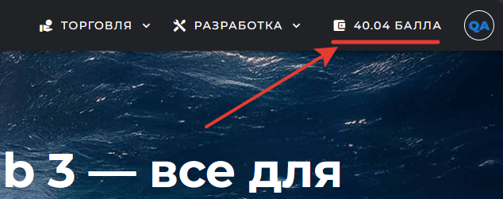
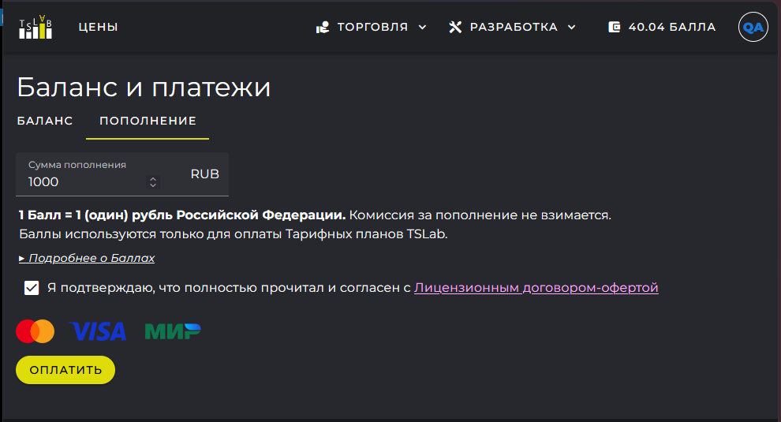
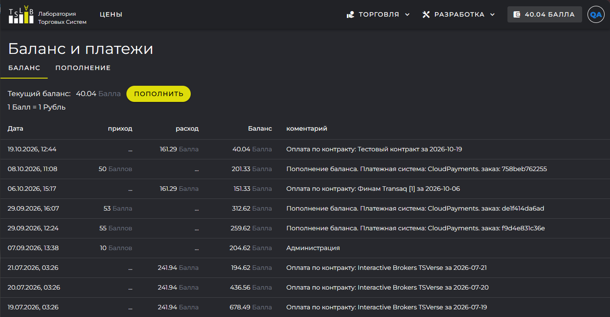

Лицевой счёт -- это ваш внутренний счёт в сервисе TSLab Online, общий для всех подписок. Вы заранее вносите на него деньги, а сервис ежедневно списывает плату за оформленные подписки. Пополнять каждую подписку отдельно не нужно: счёт один, и с него оплачиваются все ваши контракты.

Средства на счёте учитываются в Баллах. Один Балл равен одному рублю, поэтому пересчитывать ничего не придётся: внесли 3000 рублей -- на счёте появилось 3000 Баллов. Количество Баллов, которые вы ещё не израсходовали, называется Балансом. Именно он показан рядом со значком кошелька на сайте и на кнопке с вашей почтой в окне программы.

{width=634px height=251px}

Баллы расходуются только на подписки TSLab: передать их другому пользователю или расплатиться ими за что-то ещё нельзя. Неизрасходованный остаток при этом не пропадает -- его можно вернуть, об этом в конце статьи.

## Как пополнить счёт

Счёт пополняется на сайте, в разделе **Баланс и платежи**. Он открывается по значку кошелька в верхней панели.

1. Перейдите на вкладку **Пополнение**.
2. Укажите сумму, на которую хотите пополнить счёт.
3. Подтвердите согласие с условиями лицензионного договора-оферты.
4. Перейдите к оплате. Откроется страница платёжного сервиса, где вы выбираете способ оплаты и завершаете платёж.

Комиссия за пополнение не взимается: на счёт поступает вся внесённая сумма. Баллы появляются на Балансе сразу после того, как платёжный сервис подтвердит платёж. Кассовый чек приходит на адрес почты, указанный при регистрации.

{width=990px height=535px}

## Как списывается плата

Подписка в TSLab бессрочная: она действует, пока вы не отмените её сами и пока на счёте хватает Баллов. Продлевать её вручную, как это было на `tslab.pro`, не нужно.

Плата списывается за каждый день работы контракта. Стоимость одного дня считается так: месячная стоимость тарифного плана делится на число календарных дней текущего месяца. Поэтому в месяцах разной длины день стоит по-разному, а за полный месяц в любом случае набегает месячная стоимость тарифа.

Например, тарифный план стоит 5000 Баллов в месяц:

- в августе 31 день, значит один день использования стоит 161,29 Балла;
- в сентябре дней 30, и день стоит уже 166,67 Балла;
- за полный месяц в обоих случаях со счёта спишется 5000 Баллов.

Первое списание происходит в момент активации контракта, и плата берётся сразу за весь календарный день -- независимо от того, в котором часу вы активировали подписку. Минимальный оплачиваемый период составляет один день, по часам оплата не делится. Дальше плата списывается ежедневно после 00:01 по московскому времени; точное время зависит от загрузки сервера и может сдвигаться в пределах получаса.

Чтобы активировать контракт, достаточно Баллов на один день работы по выбранному тарифу. Но держать на счёте такой минимум неудобно: как только Баллов не хватит на очередной день, контракт заблокируется. Разумнее вносить сумму с запасом на несколько недель вперёд.

Если у вас несколько контрактов, плата по каждому из них списывается отдельно.

## История операций

Все движения по счёту видны на вкладке **Баланс** в разделе **Баланс и платежи**. В таблице показано, когда и сколько Баллов поступило, сколько списано и какой остаток получился после операции. В комментарии к списанию указано, за какой контракт и за какой день взята плата: по нему вы различите списания, если подписок несколько.

Суммы в таблице показаны с округлением до двух знаков после запятой, а стоимость дня сервис рассчитывает точнее. Поэтому небольшое расхождение при сложении столбца -- следствие округления, а не ошибка в расчётах.

{width=1356px height=706px}

## Если Баллов не хватило

О том, что Баллов скоро не хватит, сервис заранее предупреждает письмом на адрес почты вашей учётной записи. Если пополнить счёт вовремя, работа не прервётся.

Когда на момент очередного списания Баллов не хватает, контракт блокируется:

- поставщики данных, созданные по этому контракту, перестают работать;
- ежедневные списания по контракту прекращаются;
- сам контракт и его настройки сохраняются, данные доступа к бирже остаются на месте.

В день блокировки и в течение следующего календарного дня сервис периодически пытается списать плату снова. Как только Баллов становится достаточно, контракт возобновляется автоматически, а плата берётся за тот день, в который списание фактически прошло. Дни, которые контракт простоял заблокированным, не оплачиваются.

Ждать очередной попытки не обязательно: пополнив счёт, вы можете активировать контракт вручную в его свойствах.

Если за это время счёт не пополнен, контракт остаётся заблокированным. Срок блокировки не ограничен: контракт и данные доступа хранятся до тех пор, пока вы сами его не удалите. Чтобы вернуться к работе, пополните счёт и активируйте контракт.

Когда контрактов несколько, а Баллов хватает не на все, сервис оплатит те, на которые средств достаточно, а остальные заблокирует. Заранее предсказать, какие именно контракты окажутся оплачены, нельзя.

<note>
  Блокировка не сжигает Баланс. Баллы остаются на счёте и пойдут на оплату будущих списаний, даже если заблокированный контракт вы в итоге удалите.
</note>

## Как вернуть остаток со счёта

Неизрасходованный остаток счёта можно вернуть. Для этого обратитесь в службу поддержки -- через портал поддержки или по электронной почте.

Что стоит знать до обращения:

- возвращается Баланс на день, в который получено обращение; плата за этот день и за предыдущие дни работы не пересчитывается;
- все действующие контракты при возврате прекращаются;
- деньги возвращаются в рублях по номиналу Баллов, без удержания комиссий;
- возврат идёт тем же способом, которым вы пополняли счёт, в срок до 10 календарных дней.

Полные условия оплаты, списаний и возврата приведены в лицензионном договоре-оферте: `www.tslab.ru/legal/offer`.
