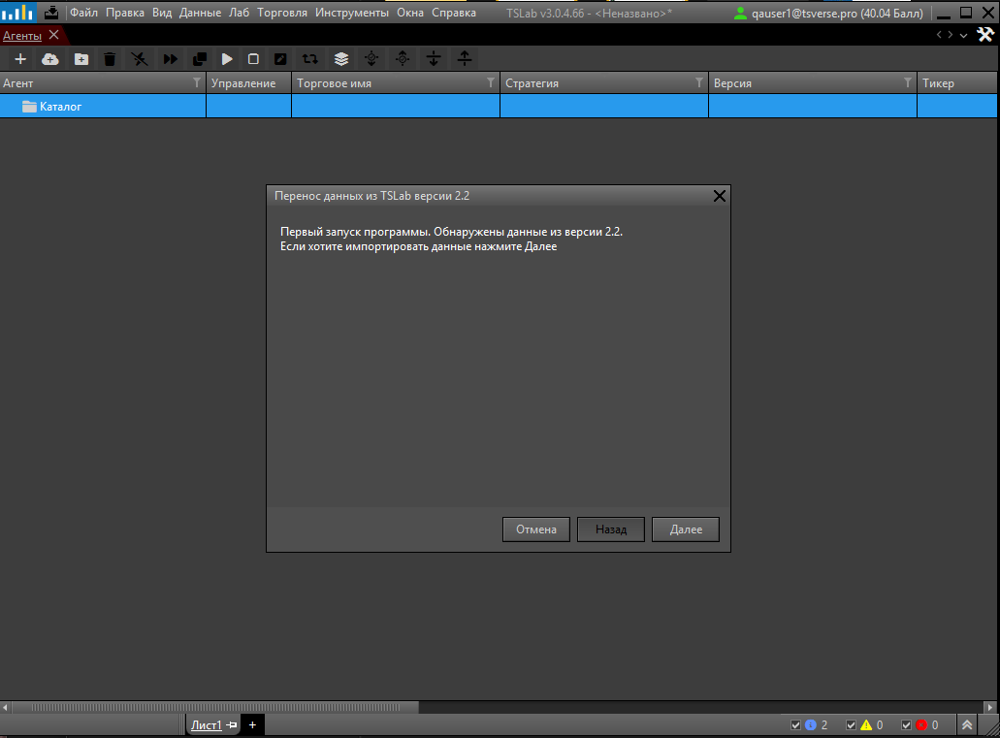
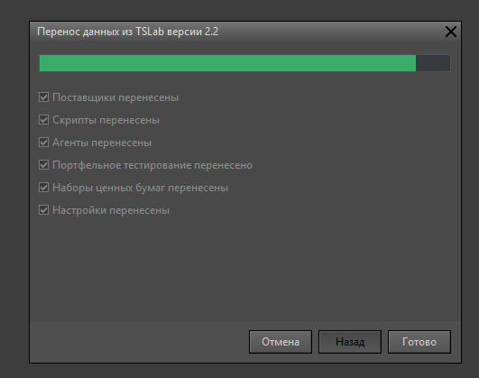
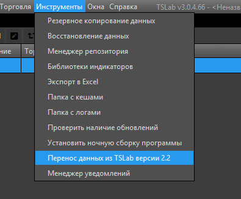

TSLab 3.0 не заменяет TSLab 2.2, а устанавливается рядом с ней: обе версии работают на одном компьютере независимо друг от друга. При первом запуске новая версия ищет данные версии 2.2 и предлагает их перенести, поэтому скрипты, настройки и поставщиков данных не придётся создавать заново.

Перенос выполняет сама программа, вручную копировать файлы не нужно. Данные версии 2.2 при этом не изменяются: TSLab 2.2 после переноса работает как прежде.

## Как пройдёт установка в вашем случае

Порядок зависит от того, какие версии программы уже установлены на компьютере.

| Что установлено {width=227px} | Что произойдёт при установке TSLab 3.0 |
|---|---|
| TSLab 2.2 | При первом запуске программа ищет данные версии 2.2. Если данные найдены, она предлагает их перенести |
| Бета-версия TSLab 3.0 | Установщик удаляет бета-версию. Её данные и настройки остаются на месте, TSLab 3.0 продолжает работать с ними |
| TSLab 2.2 и бета-версия TSLab 3.0 | Установщик удаляет бета-версию, её данные сохраняются. Перенос из TSLab 2.2 программа не предлагает |

<note type="lab">
  Бета-версию TSLab 3.0 закройте самостоятельно, перед запуском установщика: в зависимости от настроек программы автоматическое закрытие может не сработать. Удаление мастер установки выполнит сам.
</note>

Если перенос при первом запуске не состоялся -- вы отказались от него или установщик удалял бета-версию, -- запустите перенос вручную. Сделать это можно в любой момент, порядок описан ниже, в разделе «Как перенести данные позже».

## Как подготовиться к переносу

Программа читает данные версии 2.2, поэтому работу в ней нужно полностью завершить.

1. Остановите работающие скрипты и закройте открытые позиции.
2. Сделайте резервную копию данных: в главном меню TSLab 2.2 выберите **Инструменты** -> **Резервное копирование данных** и укажите в мастере, что сохранить.
3. Остановите поставщиков данных и закройте программу.

<note type="info">
  Резервная копия -- мера предосторожности. Все режимы установки протестированы, данные версии 2.2 при переносе остаются на месте. Копия нужна на случай, если вы захотите вернуть прежнее состояние: восстановление запускается через **Инструменты** -> **Восстановление данных**.
</note>

## Что переносит программа

В TSLab 3.0 переносятся:

- поставщики данных;
- скрипты;
- агенты;
- портфельное тестирование;
- наборы ценных бумаг;
- настройки.

<note type="info">
  **Что входит в настройки.**

  Переносятся настройки программы и системная конфигурация окон: состав и ширина колонок таблиц, сортировка и фильтры. Обычно в них работают значения разработчика, но вы можете заменить их своими, сохранив набор как настройки по умолчанию.

  Расположение открытых окон вы сохраняете отдельно, в файл с расширением `.tlws`. Такая конфигурация при переносе не применяется: загрузите файл вручную, через меню **Файл** -> **Загрузить**.
</note>

Кэш котировок программа не копирует: после переноса TSLab 3.0 продолжает работать с кэшем в папке версии 2.2. Как устроено хранение данных у двух версий, разобрано в статье «Где хранятся данные и котировки в TSLab 3.0».

## Как пройдёт перенос

После первого входа в учётную запись программа предлагает перенести найденные данные.

{width=1031px height=761px}

Согласитесь на перенос -- откроется окно с полосой прогресса, в котором программа отмечает выполненные пункты. Когда перенос закончится, нажмите **Готово**.

{width=531px height=419px}

<note>
  Если отказаться от переноса, при следующем запуске программа его больше не предложит. Это не потеря: данные остаются в версии 2.2, и перенести их можно позже вручную.
</note>

## Как перенести данные позже

Мастер переноса открывается через главное меню: **Инструменты** -> **Перенос данных из TSLab версии 2.2**. Запускать его можно в любое время, число запусков не ограничено. Условие одно -- данные версии 2.2 остались на компьютере, в стандартной папке этой версии.

{width=395px height=326px}

Готовиться нужно так же, как и к переносу при первом запуске: остановить скрипты, закрыть позиции и завершить работу TSLab 2.2. Перед началом программа предложит сделать резервную копию текущих данных -- рекомендуем согласиться.

<note>
  Повторный перенос заменяет данные, созданные в TSLab 3.0: скрипты, агентов, поставщиков и настройки программа берёт из версии 2.2. Вернуть прежнее состояние можно только из резервной копии -- **Инструменты** -> **Восстановление данных**.
</note>

## Что дальше

Данные перенесены, но подписка требует отдельного внимания: поставщики переходят в новую версию вместе с привязкой к контрактам старого кабинета. Что происходит с оплаченным контрактом и в каком порядке оформлять новый, разобрано в статье «Подписка при переходе на TSLab 3.0».

Где новая версия хранит базу данных и настройки, почему кэш остаётся в папке версии 2.2 и как собрать всё в одном месте -- в статье «Где хранятся данные и котировки в TSLab 3.0».
