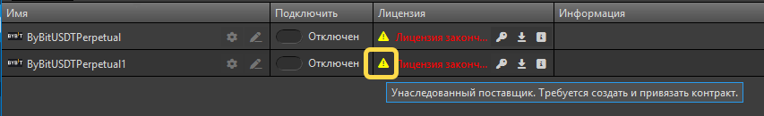
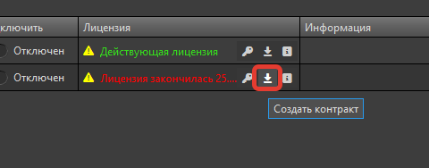
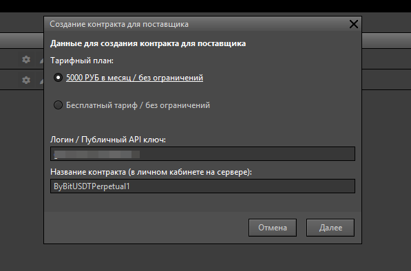
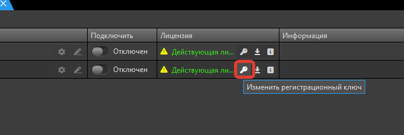
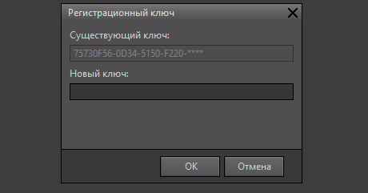

Контракт хранится в сервисе TSLab Online, а в программе ему соответствует поставщик данных. При переносе данных из TSLab 2.2 в новую версию попадают поставщики -- как проходит перенос, описано в статье [Перенос данных из TSLab 2.2](./perenos-dannykh-iz-tslab-2-2.md). Контракты остаются в старом кабинете, где вы их оформляли. Поэтому переход на новую версию программы и переход на новые контракты -- два отдельных шага, и делать их одновременно не нужно.

Учётные данные у старого кабинета и сервиса TSLab Online общие: они хранятся в единой базе, поэтому на `www.tslab.ru` вы входите тем же адресом почты и паролем, что и раньше, а регистрироваться заново не нужно. А вот контракты старого кабинета перенести в новый по техническим причинам нельзя: в разделе **Торговля** -> **Подключения** они не появятся. Обратное тоже верно -- контракт, оформленный на `www.tslab.ru`, в старом кабинете не отображается.

## Как работает перенесённый поставщик

Поставщики данных, перенесённые из версии 2.2, сохраняют названия и настройки и остаются привязанными к контрактам старого кабинета. Такой поставщик работает в TSLab 3.0 до конца оплаченного срока контракта: котировки идут, заявки отправляются, менять ничего не нужно.

Программа называет его *унаследованным поставщиком*. Найти такие поставщики можно в окне **Поставщики** (**Данные** -> **Поставщики**), в колонке **Лицензия**. У унаследованного поставщика там стоит восклицательный знак в жёлтом треугольнике, а при наведении указателя появляется подсказка «Унаследованный поставщик. Требуется создать и привязать поставщик». Рядом выводится состояние лицензии -- обычно срок действия лицензии, выданной в старом кабинете.

Полные сведения о поставщике открывает значок с буквой «i» в той же колонке. В окне **Информация** указаны тип поставщика, состояние лицензии, публичный ключ доступа и ключ лицензии.

{width=853px height=130px}

## Когда оформлять новый контракт

Момент перехода зависит от того, по какому тарифному плану вы работаете.

- **Платный тарифный план.** Дождитесь окончания оплаченного срока старого контракта -- всё это время перенесённый поставщик работает. К концу срока пополните [Лицевой счёт](./../akkaunt-i-podpiska/schet-i-podpiski.md) и оформите контракт по тому же тарифному плану на `www.tslab.ru`. Создавать поставщика заново не нужно: его подключают к новому контракту прямо в программе, порядок описан ниже, в разделе «Как подключить поставщика к новому контракту».
- **Бесплатный тарифный план.** Ожидание окончания срока не требуется: новый контракт можно оформить сразу.

Перед тем как оформить новый контракт, проверьте в старом кабинете, подключено ли автоматическое продление. Если подключено -- отключите его; если нет, никаких действий не требуется.

Как устроены контракты, какие у них статусы и как оформить контракт на сайте и в программе, разобрано в статье [Контракт](./../akkaunt-i-podpiska/kontrakty.md).

## Как подключить поставщика к новому контракту

Привязать унаследованный поставщик к сервису TSLab Online можно прямо из программы, не переходя на сайт. Для этого в окне **Поставщики** (**Данные** -> **Поставщики**), в колонке **Лицензия**, подготовлена кнопка со стрелкой вниз.

{width=480px height=188px}

1. Нажмите кнопку со стрелкой вниз. Откроется окно **Создание контракта для поставщика**.
2. Выберите тарифный план, проверьте логин или публичный API-ключ и задайте название контракта -- под ним контракт будет виден в личном кабинете.
3. Пройдите мастер до конца. Контракт создастся в сервисе TSLab Online, а поставщик сразу привяжется к нему.

{width=597px height=394px}

## Как продлить работу унаследованного поставщика

Если переходить на контракты сервиса TSLab Online вы пока не готовы, унаследованный поставщик можно продлить прежним путём: оплатить контракт в старом кабинете и ввести выданный лицензионный ключ в программе. Поставщик продолжит работать на новый оплаченный срок. Такая возможность оставлена на переходный период, пока перевод контрактов в сервис TSLab Online не завершён.

1. Оплатите контракт в старом кабинете и скопируйте лицензионный ключ.
2. Вернитесь в программу и нажмите кнопку с ключом в колонке **Лицензия**.

   {width=668px height=223px}
3. Откроется окно **Регистрационный ключ**: в верхнем поле показан текущий ключ, в нижнее введите скопированный.

   {width=460px height=241px}
4. Нажмите **ОК**.

Поставщик при этом остаётся унаследованным: жёлтый треугольник в колонке **Лицензия** сохраняется, контракт в разделе **Торговля** -> **Подключения** не появляется. Это относится и к ключу, полученному в сервисе TSLab Online: программа такой ключ принимает, но поставщик контрактным не становится.

<note>
  Замена ключа -- временная возможность. Она перестанет работать после закрытия старого кабинета. Чтобы перейти на контракты TSLab Online, нажмите кнопку со стрелкой вниз и создайте контракт.
</note>

После привязки поставщик перестаёт быть унаследованным: программа называет его *контрактным*. Жёлтый треугольник в колонке **Лицензия** сменяется зелёной отметкой **Активный контракт**, а набор значков в строке меняется -- вместо замены ключа и создания контракта появляются **Изменение учетных данных** и **Смена контракта поставщика**. Что это за окна и когда они нужны, описано в разделе «Поставщики данных».

## Как работать по новому контракту в TSLab 2.2

Менять версию программы ради нового кабинета не обязательно. Контракт, оформленный в сервисе TSLab Online, выдаёт лицензионный ключ для TSLab 2.2 -- тот самый, который версия 2.2 запрашивает при настройке поставщика данных.

1. Оформите контракт на `www.tslab.ru` и активируйте его.
2. Откройте свойства контракта, вкладка **Основное**, поле **Лицензионный ключ**. Значение скрыто -- покажите его значком с глазом и скопируйте.
3. Введите ключ в TSLab 2.2 при настройке поставщика данных.

<note type="info">
  Лицензионный ключ появляется только после активации контракта. Пока контракт в статусе **Выключен**, в поле написано «Не доступен».
</note>

## Что дальше

С контрактами разобрались, остаётся хранение данных: где TSLab 3.0 держит базу и настройки, почему кэш котировок остаётся в папке версии 2.2 и что происходит, если работать в двух версиях по очереди. Об этом -- в статье «Где хранятся данные и котировки в TSLab 3.0».
