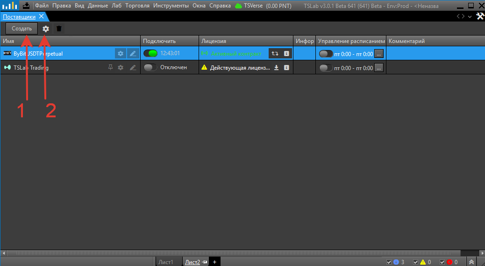
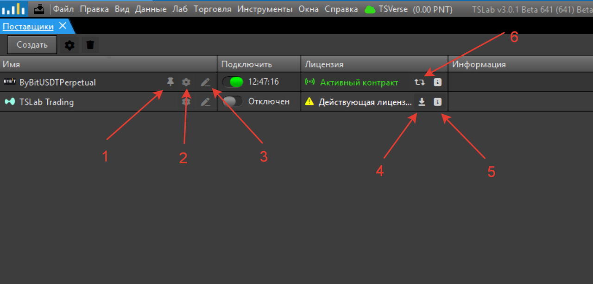

## Основное меню окна

В TSLab 3.0 изменился интерфейс управления поставщиками данных. Основные изменения касаются кнопок управления в верхней части окна.

{width=1038px height=569px}

**Ключевые элементы:**

**1\. Создать** -- открывает окно **Создать поставщик данных** с тремя вкладками:

- **Из существующего контракта** -- отображает список всех контрактов пользователя в TSLab Online. Контракты представлены в виде свёрнутого списка. При нажатии на стрелочку рядом с названием контракта раскрывается список поставщиков, которые можно создать из этого контракта. После выбора нажмите **Далее** для создания поставщика
- **С созданием контракта** -- показывает список всех доступных поставщиков в программе. После выбора нужного поставщика данных пользователь переходит к процедуре создания контракта в программе с последующим созданием поставщика
- **Из исторических данных** -- для работы с текстовыми поставщиками данных

**2\. Настройки** (⚙️) -- открывает настройки выбранного поставщика

## Управление отдельными поставщиками

Для каждого поставщика в списке доступны дополнительные функции управления.

{width=1280px height=614px}

**Ключевые элементы:**

1. **Закрепить** (📌) -- добавляет кнопку включения/отключения поставщика в строку состояния (нижняя панель программы, где расположены переключение между листами и журнал сообщений)
2. **Настройки** (⚙️) -- открывает настройки поставщика
3. **Изменить пользовательское имя поставщика** (✏️) -- открывает окно для изменения названия поставщика в программе. Имя в других окнах обновится только после перезагрузки программы
4. **Создать контракт** (⬇️) -- отображается для поставщиков, мигрировавших из TSLab 2.2. При нажатии создаётся новый контракт в сервисе TSLab Online. Для платных тарифных планов убедитесь, что на Лицевом счёте достаточно Баллов
5. **Информация о лицензии** (ℹ️) -- показывает тип контракта, статус, публичный API-ключ (логин) и ключ лицензии
6. **Изменение учётных данных** (🔄) -- открывает окно для изменения учётных данных контракта

## Изменение учётных данных

Один контракт может использоваться для создания нескольких поставщиков данных, в том числе на разных компьютерах. В окне **Изменение учётных данных** можно изменить:

**Публичный API-ключ (логин):**

- Изменения сохраняются на сервере TSLab Online
- Автоматически применяются ко всем поставщикам, созданным из этого контракта
- В том числе на других компьютерах

**Секретный API-ключ (пароль):**

- Изменения применяются только к поставщикам на текущем компьютере
- На других компьютерах секретный ключ необходимо изменить вручную
- Сервис TSLab Online не хранит секретные API-ключи (пароли) на сервере

## Статус контракта

В столбце **Лицензия** отображается информация о статусе контракта при подключении к TSLab Online:

- **Активный** -- контракт действует, списание происходит регулярно
- **Завершённый** -- контракт отменён или истёк срок действия

## Отличия от TSLab 2.2

В TSLab 2.2 для управления лицензиями использовалась кнопка **Ключ**, в которую нужно было вручную вводить лицензионный ключ из личного кабинета [tslab.pro](http://tslab.pro). В TSLab 3.0 эта система заменена на контракты в TSLab Online -- лицензия автоматически привязывается к аккаунту при создании поставщика или контракта.
