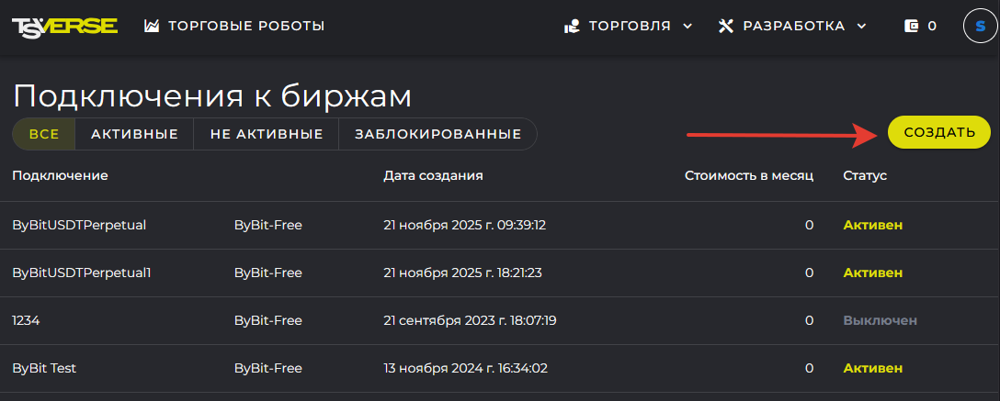
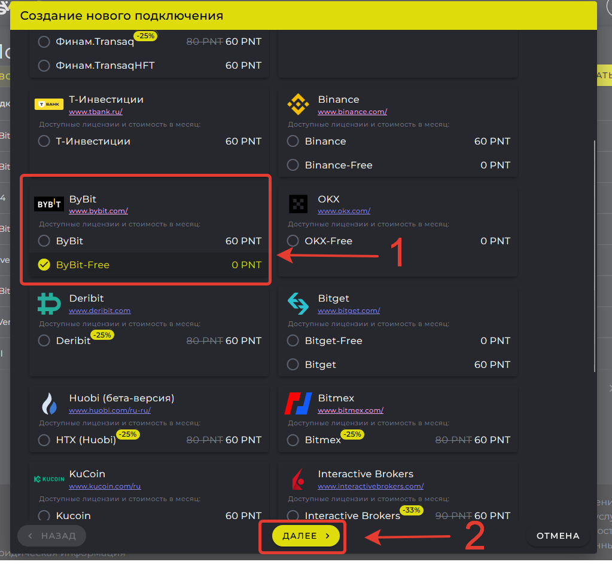
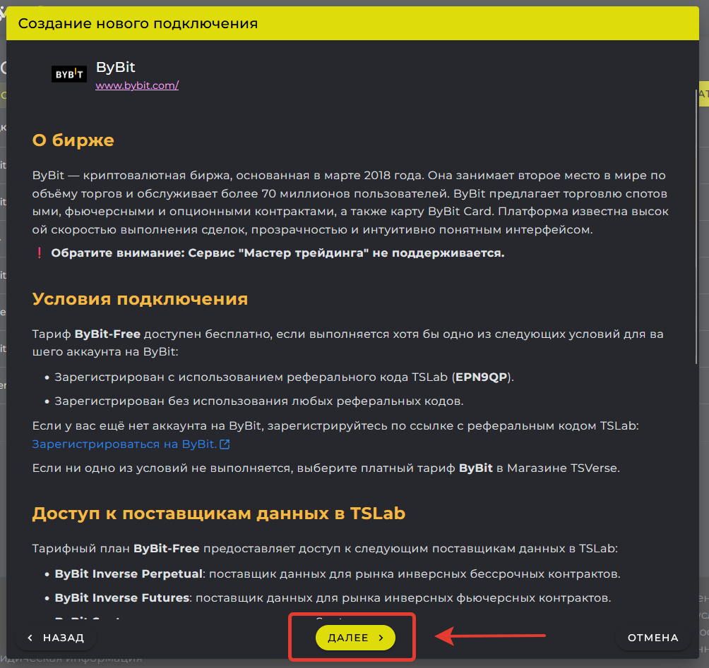
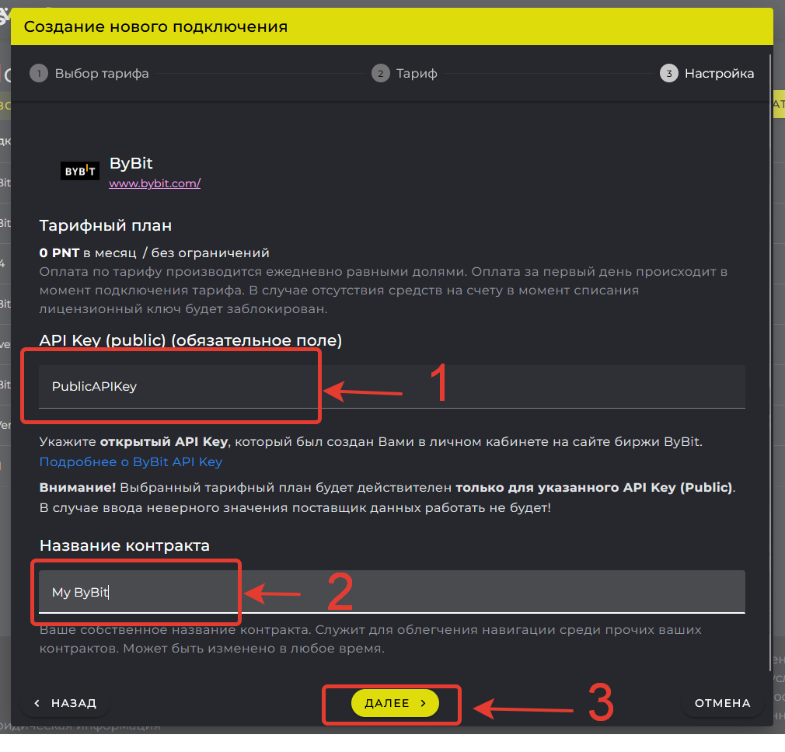
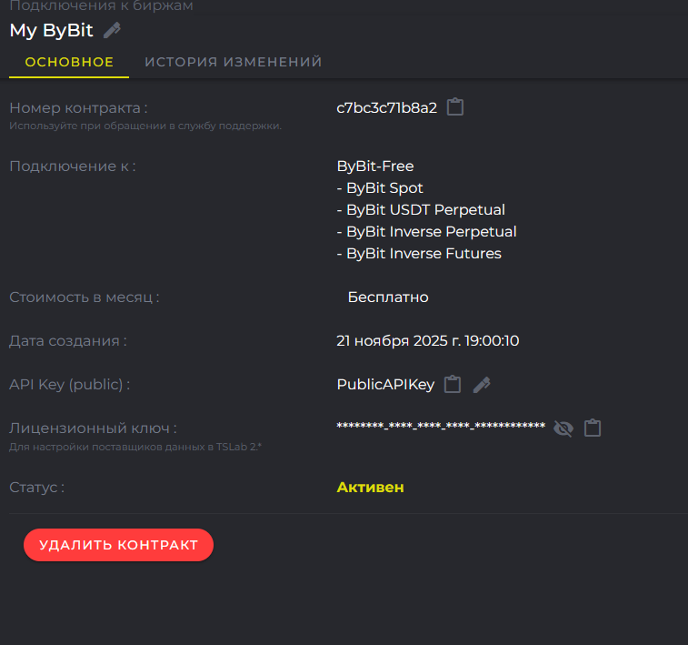
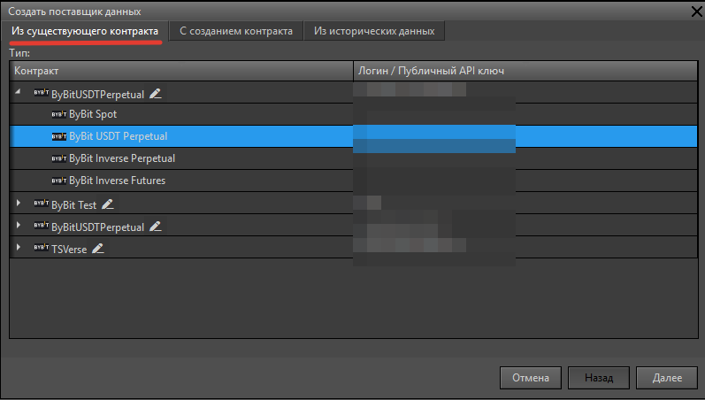
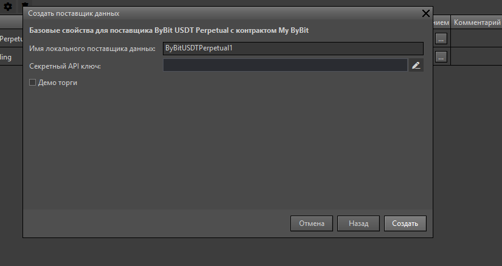
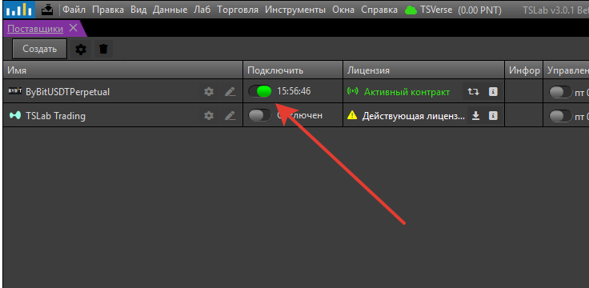

Контракт оформляется на сайте, поставщик создаётся в программе. Порядок действий рассмотрим на примере криптобиржи ByBit.

1. **Откройте раздел подключений на сайте.**

   Войдите на сайт `www.tslab.ru` и перейдите: **Торговля -> Подключения**. Нажмите **Создать**.

   {width=1088px height=437px scale=86}
2. **Выберите тарифный план.**

   Выберите поставщика **ByBit-Free** из списка и нажмите **Далее**. Изучите условия тарифа и снова нажмите **Далее**.

   {width=1023px height=956px scale=82}

   {width=1004px height=947px scale=82}
3. **Укажите учётные данные контракта.**

   Введите **Public API Key** в соответствующее поле. Укажите название контракта (необязательно). Нажмите **Далее**.

   {width=1010px height=968px scale=82}
4. **Активируйте контракт.**

   Нажмите **Активировать контракт** (для платных тарифов). Подписка создана и активирована.

   {width=757px height=709px scale=80}
5. **Создайте поставщика в программе.**

   Откройте окно **Поставщики** в TSLab 3.0 и нажмите кнопку **Создать**.

   {width=874px height=415px scale=83}
6. **Выберите контракт.**

   Выберите вкладку **Из существующего контракта**. В списке найдите созданный контракт и раскройте список поставщиков данных, которые можно создать из этого контракта. Для примера выберем ByBit USDT Perpetual. Нажмите **Далее**.

   {width=797px height=452px scale=82}
7. **Настройте поставщика.**

   Задайте название, например «ByBit Основной». Введите **Secret Key** с биржи ByBit. Проверьте остальные параметры и нажмите **Создать**.

   {width=826px height=438px scale=85}
8. **Подключитесь к бирже.**

   В окне **Поставщики** найдите созданного поставщика и нажмите кнопку **Подключить**.

   {width=736px height=360px scale=84}

<note type="lab">
  **При проблемах с подключением**

  1. Проверьте правильность Public Key в настройках подписки на `www.tslab.ru`
  2. Проверьте правильность Secret Key в настройках поставщика в TSLab
  3. Убедитесь, что API-ключ на бирже имеет права на чтение и торговлю
  4. Проверьте Баланс Лицевого счёта (для платных тарифных планов)
  5. Обратитесь в службу поддержки с номером контракта (доступен на `www.tslab.ru` -> Подключения)
</note>
