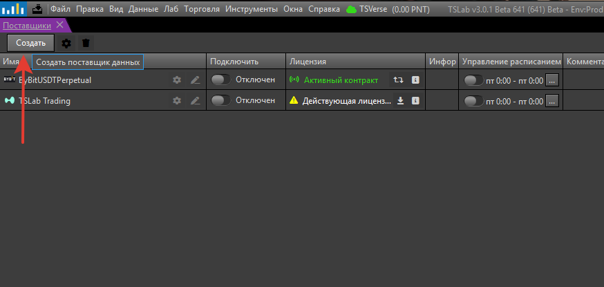
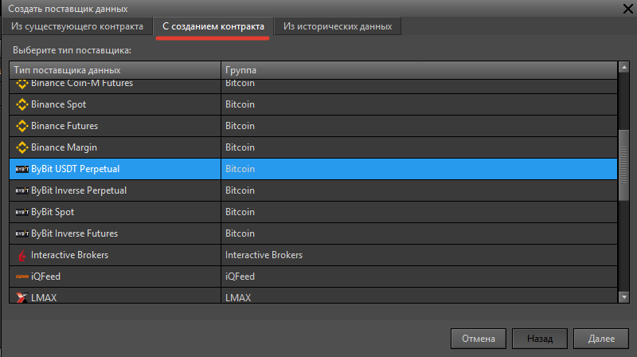
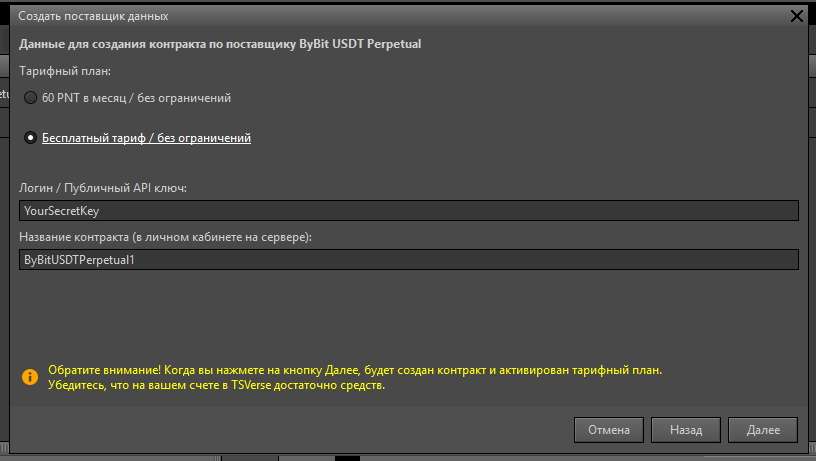
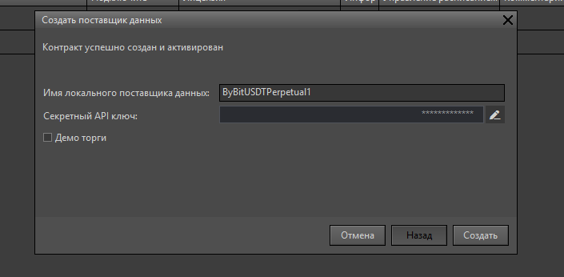

Контракт и поставщик создаются за один проход, не выходя из программы. Порядок действий рассмотрим на примере криптобиржи ByBit.

1. **Откройте мастер создания поставщика.**

   Откройте окно **Поставщики**: **Главное меню -> Данные -> Поставщики**. Нажмите кнопку **Создать**.

   {width=874px height=415px}
2. **Выберите поставщика данных.**

   В открывшемся окне выберите вкладку **С созданием контракта**. В списке найдите требуемый поставщик данных, например ByBit USDT Perpetual. Нажмите **Далее**.

   {width=800px height=448px scale=87}
3. **Оформите контракт.**

   Выберите тарифный план -- для поставщика данных ByBit доступен бесплатный тарифный план (при соблюдении условий). В поле **Публичный ключ** введите **Public API Key** с биржи ByBit. В поле **Название контракта** (необязательно) укажите удобное для вас имя. Нажмите **Далее**.

   {width=816px height=461px scale=89}
4. **Настройте поставщика.**

   В поле **Имя локального поставщика данных** задайте имя, например «ByBit Основной». В поле **Секретный API ключ** введите **Secret Key** с биржи ByBit. Нажмите **Создать**.

   {width=705px height=346px scale=83}
5. **Подключитесь к бирже.**

   В окне **Поставщики** найдите созданного поставщика и нажмите кнопку **Подключить** (слайдер). Дождитесь изменения статуса на 🟢 зелёный -- подключение успешно.

   {width=736px height=360px scale=82}

<note type="tip">
  **Что происходит после создания**

  - Автоматически создаётся подписка на тарифный план в сервисе TSLab Online
  - Списывается оплата за первый день (для платных тарифов)
  - Подписка привязывается к вашему аккаунту
  - Поставщик готов к использованию
</note>
