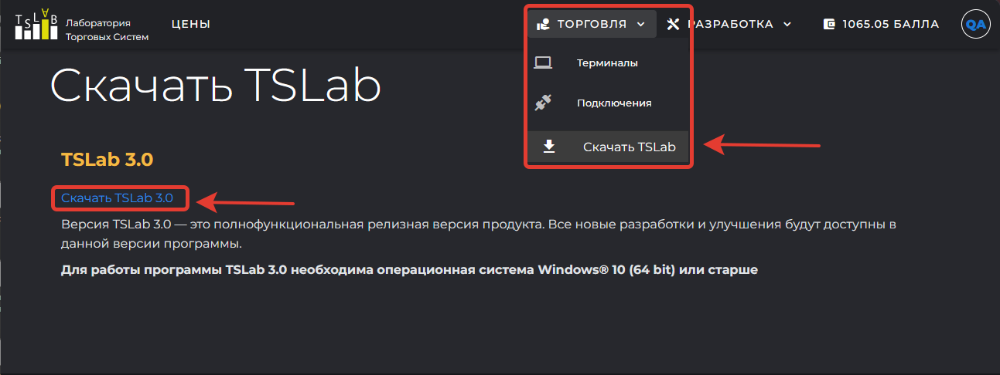
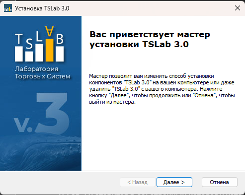
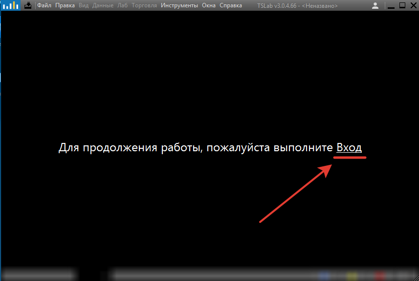

TSLab 3.0 устанавливается на компьютер как обычная программа для Windows: вы скачиваете с официального сайта один установочный файл и запускаете его. Работать в программе можно только после входа в учётную запись -- в версии 3.0 авторизация обязательна.

<note>
  Статья описывает установку TSLab 3.0 на компьютер, где версия 2.2 не установлена. Если вы работаете в TSLab 2.2 и собираетесь перенести свои данные в новую версию, обязательно прочитайте раздел [«Переход с TSLab 2.2»](./../perekhod-s-tslab-2-2/_index.md): там описана правильная последовательность действий.
</note>

## Где скачать программу

Установочный файл выложен на официальном сайте. Откройте `www.tslab.ru`, войдите в учётную запись и выберите в верхнем меню **Торговля** -> **Скачать TSLab**. Скачайте файл `TSLab30RuSetup.exe` и сохраните его в любую папку на компьютере.

{width=1293px height=486px}

Если учётной записи ещё нет, зарегистрируйтесь: это занимает несколько минут и требует подтверждения адреса почты. Порядок разобран по шагам в статье [Регистрация и вход в аккаунт](./../akkaunt-i-podpiska/registraciya-i-vkhod-v-akkaunt.md). Эта же учётная запись понадобится программе при первом запуске, отдельной регистрации для неё нет.

<note type="info">
  TSLab -- программа для Windows. Версий для macOS и Linux не существует, а запуск через виртуальные машины и средства совместимости штатным режимом работы не считается. Перед установкой проверьте, что компьютер отвечает [системным требованиям](./sistemnye-trebovaniya/_index.md).
</note>

## Установка

Специально готовить компьютер к установке не нужно: закрывать работающие программы, освобождать место сверх указанного в системных требованиях или заранее устанавливать системные компоненты не требуется.

Запустите скачанный файл. Мастер установки проведёт вас по трём шагам: вы принимаете условия лицензионного соглашения, указываете каталог, в который будет установлена программа, и подтверждаете начало установки. Когда копирование файлов закончится, программа готова к запуску.

{width=493px height=393px}

Недостающие системные компоненты установщик добавляет сам. Если на компьютере нет нужной версии платформы .NET, он загрузит и установит её по ходу установки: скачивать что-либо с сайта Microsoft заранее не нужно.

TSLab 3.0 ставится в собственный каталог и установленную TSLab 2.2 не затрагивает. Обе версии могут работать на одном компьютере.

<note type="tip">
  Если установка или запуск программы блокируются, причина чаще всего в антивирусе или брандмауэре. Добавьте TSLab в список исключений и повторите установку.
</note>

## Первый запуск

Запустите установленную программу. Откроется главное окно TSLab, но рабочая область будет заблокирована: она закрыта полупрозрачной заливкой, большинство пунктов главного меню недоступно, и программа требует авторизации.

В центре окна выводится надпись **«Для продолжения работы, пожалуйста выполните Вход»**, где слово **Вход** подчёркнуто и работает как ссылка.

Сам вход выполняется не в программе, а в браузере. Когда вы нажимаете ссылку, TSLab открывает страницу авторизации в браузере, выбранном в системе по умолчанию. Введите на ней адрес почты и пароль своей учётной записи. Как только вход выполнен, программа снимает блокировку: заливка исчезает, главное меню и окна становятся доступны.

{width=857px height=576px}

## Что дальше

Сразу после входа программа пуста: в ней нет ни котировок, ни готовых скриптов. Прежде чем собирать и проверять стратегии, нужно получить данные, и сделать это можно двумя способами.

Первый способ -- подключить поставщика данных. Так программа связывается с биржей или брокером, получает котировки и в дальнейшем отправляет торговые поручения. Поставщик работает по подписке: как она устроена, из чего складывается стоимость и как её оформить, рассказано в разделе [Аккаунт и подписка](./../akkaunt-i-podpiska/_index.md), а настройка самого подключения -- в разделе «Поставщики данных».

Второй способ -- загрузить котировки из текстовых файлов, если они у вас уже есть. Программа принимает текстовые файлы установленного образца, и плата за работу с ними не взимается. Как подготовить и загрузить такой файл, описано в разделе про работу с данными.

Разобраться в устройстве самой программы поможет раздел [Знакомство с интерфейсом](./../interfeys/_index.md): там описано рабочее пространство, порядок работы с окнами и вкладками и сохранение привычного расположения.
