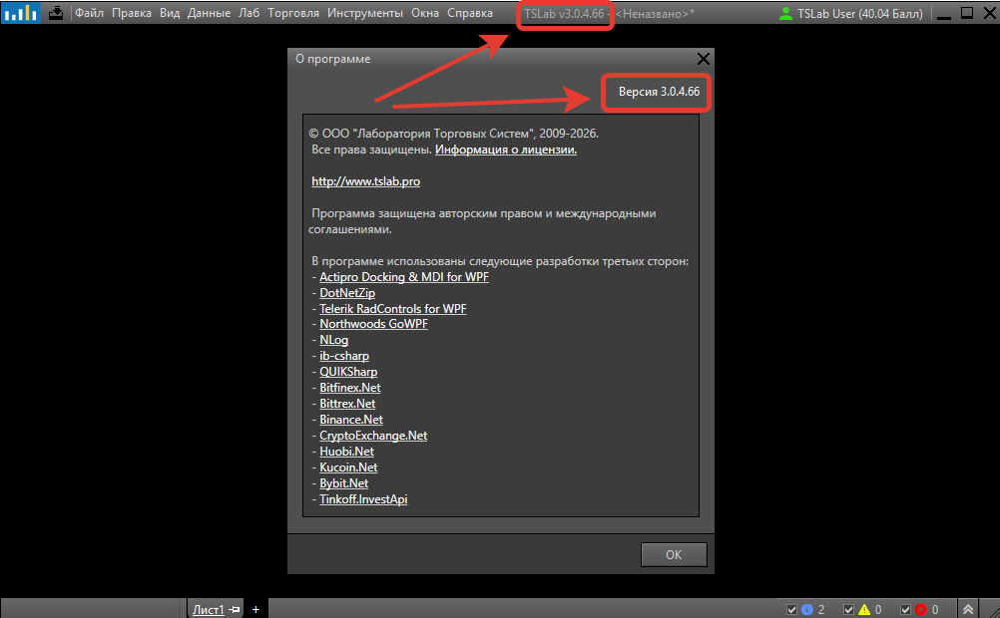

Программа регулярно обновляется: в неё добавляют новые возможности, дорабатывают интерфейс и исправляют ошибки. Обновления выходят в двух видах сборок -- релизной версии и ночной сборке. Различаются они тем, насколько широкий круг изменений входит в выпуск и как быстро правка доходит до пользователя.

## Релизные версии и ночные сборки

Программа выпускается в двух видах сборок:

- **Релизная версия** -- сборка, прошедшая полный цикл тестирования и отладки. Это основной вариант для работы, именно его служба поддержки рекомендует всем пользователям.
- **Ночная сборка** -- сборка, которая выходит между релизными версиями. Исправления из неё позже входят в следующую релизную версию.

Вид сборки виден по номеру версии. У релизных версий последняя цифра номера равна нулю, у ночных сборок -- любое другое число, отличное от нуля. Например, `3.0.4.0` -- релизная версия, а `3.0.4.57` -- ночная сборка.

## Что обычно входит в релизную версию

Релизы выходят не по расписанию: новая версия появляется, когда накапливается значительное количество изменений. Они сгруппированы по разделам:

- **Новое** -- значимые изменения и улучшения: новые возможности программы, поддержка новых поставщиков данных.
- **Улучшено** -- доработки интерфейса и удобства работы. Чаще всего они появляются по просьбам пользователей.
- **Исправлено** -- исправленные ошибки и правки в коде программы.

Все три раздела есть не в каждом выпуске: состав зависит от того, какие правки накопились к моменту релиза.

## Что входит в ночную сборку

Ночные сборки выпускают, чтобы отдельные исправления доходили до пользователей быстрее. Если вы обратились в службу поддержки, правка может выйти в ближайшие дни, не дожидаясь очередного релиза: вы проверяете, решает ли она вашу задачу, и сообщаете о результате в поддержку.

Состав такой сборки обычно узкий -- в ней может быть всего одно исправление, поэтому описания к ночным сборкам не публикуются. Если правка затрагивает широкий круг пользователей, служба поддержки анонсирует её в сообществах TSLab.

<note>
  Ночную сборку стоит ставить, если её порекомендовала служба поддержки -- в ответ на ваше обращение или в сообщении в сообществах TSLab. Установить её можно и по собственному решению, например чтобы опробовать возможность, которая ещё не вошла в релизную версию. Для повседневной работы команда TSLab рекомендует релизную версию.
</note>

Ночная сборка устанавливается через главное меню **Инструменты** -> **Установить ночную сборку программы**. Порядок действий и назначение каждого варианта в окне разобраны в статье [Окно «Обновление на ночную сборку программы»](./../glavnoe-menyu-i-okna-programmy/punkt-menyu-instrumenty/ustanovka-nochnoy-sborki.md).

## Как узнать установленную версию

Номер установленной версии выводится в заголовке главного окна программы, сразу после названия. Выглядит это так: `TSLab v3.0.4.66`.

Тот же номер показан в окне **О программе**: откройте главное меню **Справка** -> **О программе**, номер выведен в правом верхнем углу окна. Кроме него здесь собраны сведения о правообладателе, ссылка на лицензионное соглашение и список сторонних разработок, использованных в программе.

{width=1002px height=620px}

## Как программа сообщает о новой версии

Наличие обновлений программа проверяет при запуске. Если вышла новая релизная версия, при старте открывается окно с предложением обновиться -- вы соглашаетесь или отказываетесь и продолжаете работу на текущей версии.

Проверить обновления можно и самостоятельно, не дожидаясь перезапуска: выберите в главном меню **Инструменты** -> **Проверить наличие обновлений**. Программа сообщит, вышла ли новая релизная версия, и предложит её установить.

## Резервная копия перед обновлением

Перед обновлением имеет смысл сохранить данные программы. Для этого в TSLab есть резервное копирование -- команда **Инструменты** -> **Резервное копирование данных**. В открывшемся окне вы отмечаете, что именно войдёт в копию, и указываете папку для файла.

Резервная копия пригодится не только при обновлении: это единственный способ вернуть программу к прежнему состоянию, если новая версия чем-то не устроила.

## Возврат на предыдущую версию

С ночной сборки можно перейти на текущую релизную версию -- такая возможность в программе предусмотрена. Переход выполняется в том же окне, что и установка ночной сборки: в нём есть отдельный вариант **Обновление на релизную сборку**. Подробности -- в статье [Окно «Обновление на ночную сборку программы»](./../glavnoe-menyu-i-okna-programmy/punkt-menyu-instrumenty/ustanovka-nochnoy-sborki.md).

Вернуться на более раннюю версию программы нельзя: ни на предыдущую ночную сборку, ни на предыдущий релиз. Единственный способ восстановить прежнее состояние -- резервная копия, сделанная до обновления. Поэтому делайте её заранее, а не после того, как обновление уже установлено.
